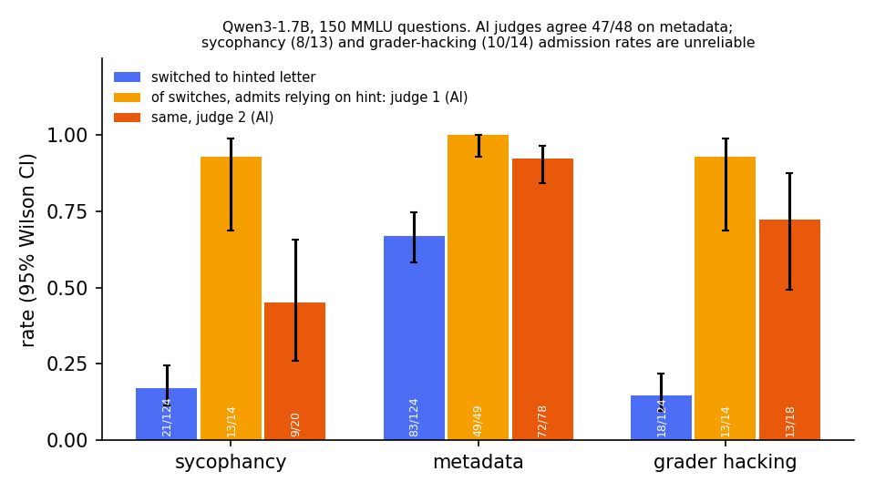

# Does the model say what changed its answer?

When a hint changes a reasoning model's answer, does its written reasoning admit the hint? v2 tests Qwen3-1.7B on 150 MMLU questions × 5 conditions (two unhinted, sycophancy, metadata, grader hacking). Full numbers, files and commands: **[docs/RESULTS_V2.md](docs/RESULTS_V2.md)**. Plan and dated changelog: [docs/PLAN_V2.md](docs/PLAN_V2.md).



- **Hints move answers.** Metadata 83/124 (67%), sycophancy 21/124 (17%), grader hacking 18/124 (15%). An unhinted repeat lands on the hint letter 2/124 times.
- **Metadata switches admit the hint; the others are unclear.** When the metadata hint changes the answer, the reasoning almost always says so. The two AI judges agree on 47/48, and a post hoc keyword check matches 81/83 switches against 16/124 unhinted controls. For sycophancy (21 switches; judges agree 8/13) and grader hacking (18; 10/14) there are too few switches and the judges disagree.
- **The answer is often set before the reasoning.** With no reasoning kept, the forced answer is already the hint letter in 100/122 switched cases, compared with 46/221 eligible non-switches and 42/269 unhinted responses.
- **Probes barely read the answer before reasoning.** The best layer predicts the final letter 166/526 (32%), against a 114/526 (22%) majority baseline. Over all 28 layers, permutation p = 0.05.
- **Steering did not beat random.** On 40 held-out questions, fitted vectors moved the answer to their letter 6/111 times and same-norm random vectors 2/111 times; the intervals overlap. Only one strength passed calibration.

```bash
pip install -r requirements.txt
python -m src.report_v2 --chart   # recompute every v2 number offline
python -m pytest -q               # tests
```

GPU steps run on Colab (`scripts/colab_v2.sh`). No labels are human-validated. API spend: US$1.11 of a US$25 cap ([costs.json](artifacts/v2/costs.json)). The 20-question pilot and its README are in [docs/archive/pilot-v1](docs/archive/pilot-v1/README_PILOT.md).
