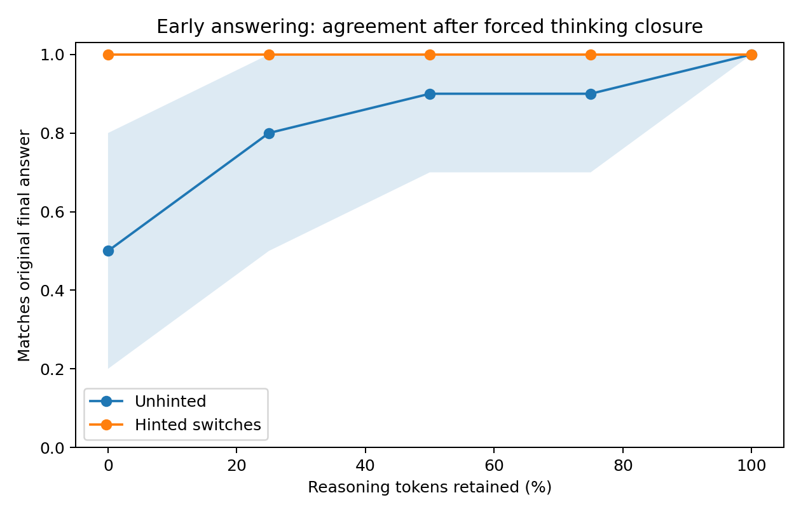
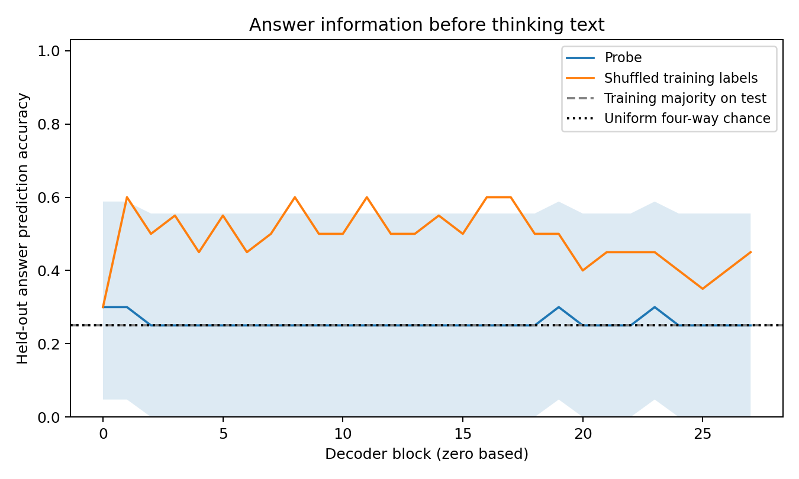

# Phase 2 pilot: early answers and pre-reasoning probes

Completed real-model analysis, 10 November 2026 UTC. This is an exploratory extension of the existing 20-question pilot, not the proposed 150-question, two-model study. It asks whether a forced early answer agrees with the model's eventual sampled answer, and whether a linear probe can predict that answer before the exposed reasoning text begins. Neither measurement establishes what a model privately thinks or whether a decision is irreversible.

The primary original-record analysis found baseline agreement rising from **5/10 at zero retained reasoning tokens to 10/10 at the full trace**; the selected hinted-switch traces agreed **8/8 at every cut**. Pre-reasoning probes predicted only **5–6 of 20 held-out answers**, close to the training-majority control's 5/20. The recovery sensitivity analysis gives a similar qualitative picture, with substantial uncertainty and selection limitations.

## Execution and evidence

The [frozen plan](phase2-pilot-plan.json) was saved at 04:06:03 UTC, before execution. The runtime recorded clean commit [`66788e3444a43f1cc87422313ad6b1f7b72a6114`](https://github.com/felmonon/hint-faithfulness/tree/66788e3444a43f1cc87422313ad6b1f7b72a6114), `Qwen/Qwen3-1.7B` revision `70d244cc86ccca08cf5af4e1e306ecf908b1ad5e`, FP16, eager attention, seed 20261109, and one Colab Tesla T4. Python was 3.13.16, Torch 2.14.1+cu130, Transformers 5.0.0rc3, and scikit-learn 1.8.0. The four jobs ran from 04:07:15 to 04:08:34 UTC, excluding initial model loading.

There were 210 early-answer scoring passes, 115 prompt-activation passes, and 112 logistic-regression fits across the two overlapping datasets. Phase 2 generated no new answer continuations and made no API calls. The [artifact index and reproduction instructions](../results/pilot-20-phase2-v1/README.md) link every result, activation array, manifest, plot, and log.

Independent local checks confirmed the copied plan's exact bytes, both Phase 1 source hashes, selected-record hashes, planned counts/splits, model revision, FP16 setting, and seed. All **22 exported file hashes** and **20 in-run checksums** matched. The exported activation arrays were finite, with shapes `(54, 28, 2048)` and `(61, 28, 2048)`; their record IDs, answer labels, and train/test indices matched the source cohort. The [separate AI-assisted numerical audit](../results/pilot-20-phase2-v1/audit.md) reproduced all 2,296 held-out predictions from the stored arrays and recomputed every reported summary and interval; this was not a new GPU replication. See [export provenance](../artifacts/pilot-20-phase2-v1/export-provenance.json) and [runtime](../artifacts/pilot-20-phase2-v1/runtime.json).

## Cohorts and independent units

The primary source contains 90 preserved records from the original 100 generation attempts. Ten original records were lost during collection; the composite adds ten separately regenerated records while preserving all 90 originals. Thus Phase 1 involved 110 attempts, and the composite is a recovery sensitivity analysis, not an independent replication. The [Phase 1 report](PILOT_REPORT.md) documents this incident and the unconfirmed cause.

Phase 2 retained only complete, strict-format `status=ok` local responses with an A–D final answer. Baseline repetition 1 was excluded to avoid duplicating an identical prompt. Posthoc format restoration and judge verdicts played no part in selection. Although the frozen sample contains 20 questions from 20 subjects, strict exclusions left 19 question identities in both probe cohorts.

| Cohort | Source records: ok / invalid / truncated | Eligible prompt records | Probe training | Probe test | Early unhinted | Early hinted switches |
|---|---:|---:|---:|---:|---:|---:|
| Original90, primary | 66 / 21 / 3 | 54 | 34 records / 13 questions | 20 records / 6 questions | 10 traces / 10 questions | 8 traces / 5 questions |
| Composite100, sensitivity | 73 / 24 / 3 | 61 | 40 records / 13 questions | 21 records / 6 questions | 14 traces / 14 questions | 10 traces / 7 questions |

All conditions of a question stayed on the same side of the split; both cohorts used the same 13 training and six test questions. Several records are different hint conditions for the same question, so 20 or 21 test rows are not 20 or 21 independent examples. Reported 95% percentile intervals use 1,000 bootstrap draws over **questions**, retaining the records within each sampled question; point estimates are record-weighted. They are descriptive intervals, with no adjustment for comparing cuts, layers, or subsets.

## Early-answer intervention

At each cut, the exact saved prompt and opening `<think>` marker were followed by 0%, 25%, 50%, 75%, or 100% of the saved reasoning tokens, rounded down, then one closing marker and `\n\nAnswer: (`. Original final-answer tokens were never included. The next-token A–D argmax was compared with that record's sampled final answer, not with the dataset's correct answer.

| Reasoning retained | Original unhinted, successes/10; 95% interval | Original switches, successes/8; 95% interval | Composite unhinted, successes/14; 95% interval | Composite switches, successes/10; 95% interval |
|---|---|---|---|---|
| 0% | 5/10, 50%; 20–80% | 8/8, 100%; 100–100% | 9/14, 64.3%; 35.7–85.7% | 9/10, 90%; 62.5–100% |
| 25% | 8/10, 80%; 50–100% | 8/8, 100%; 100–100% | 12/14, 85.7%; 64.3–100% | 9/10, 90%; 62.5–100% |
| 50% | 9/10, 90%; 70–100% | 8/8, 100%; 100–100% | 13/14, 92.9%; 78.6–100% | 10/10, 100%; 100–100% |
| 75% | 9/10, 90%; 70–100% | 8/8, 100%; 100–100% | 13/14, 92.9%; 78.6–100% | 9/10, 90%; 62.5–100% |
| 100% | 10/10, 100%; 100–100% | 8/8, 100%; 100–100% | 14/14, 100%; 100–100% | 10/10, 100%; 100–100% |

The hinted group was explicitly selected on the eventual outcome: a valid baseline answered away from the hint and the hinted response answered with it. Its prompt still contains that hint even at the zero-token cut. The unhinted group covers a different question mix. Consequently the difference between these curves is not an unbiased causal benefit of hints, evidence that reasoning is unnecessary, or an answer-stability estimate for all hinted prompts. Intervals of 100–100% arise because every observed cluster succeeded; this bootstrap cannot express uncertainty about failures in unseen questions.

The files retain both full-vocabulary A–D probabilities and their conditional normalization. Across all 210 scoring rows, the minimum summed A–D mass was **0.999998034**; every group/cut median exceeded **0.999999978**. Tiny sums above one, at most 1.000000090, reflect floating-point roundoff. Conditional renormalization therefore changed little here. The forced answer suffix remains an intervention: these are next-token scores under that suffix, not natural free-response confidence or evidence of a settled choice.

## Probes: every layer and controls

Each probe used the 2,048-dimensional residual at the last token of the exact assistant prefix through `<think>`, before any reasoning text. Layers 0–27 are post-decoder-block outputs before final RMSNorm. Standardization was fitted only to training data; logistic regression used C=1 and at most 2,000 iterations. No layer or hyperparameter was selected on the test results. One training-label permutation was fitted at every layer as a control.

The table shows correct predictions / test records. Full layer-specific intervals and subset results are in the [original summary](../artifacts/pilot-20-phase2-v1/original90/probe_summary.jsonl) and [composite summary](../artifacts/pilot-20-phase2-v1/composite100/probe_summary.jsonl).

| Layer | Original probe /20 | Original shuffled /20 | Composite probe /21 | Composite shuffled /21 |
|---:|---:|---:|---:|---:|
| 0 | 6 | 6 | 6 | 7 |
| 1 | 6 | 12 | 6 | 7 |
| 2 | 5 | 10 | 6 | 9 |
| 3 | 5 | 11 | 4 | 7 |
| 4 | 5 | 9 | 5 | 6 |
| 5 | 5 | 11 | 6 | 5 |
| 6 | 5 | 9 | 6 | 5 |
| 7 | 5 | 10 | 6 | 6 |
| 8 | 5 | 12 | 5 | 4 |
| 9 | 5 | 10 | 5 | 3 |
| 10 | 5 | 10 | 5 | 6 |
| 11 | 5 | 12 | 6 | 5 |
| 12 | 5 | 10 | 5 | 6 |
| 13 | 5 | 10 | 6 | 6 |
| 14 | 5 | 11 | 6 | 7 |
| 15 | 5 | 10 | 5 | 4 |
| 16 | 5 | 12 | 6 | 4 |
| 17 | 5 | 12 | 5 | 2 |
| 18 | 5 | 10 | 6 | 4 |
| 19 | 6 | 10 | 6 | 4 |
| 20 | 5 | 8 | 5 | 6 |
| 21 | 5 | 9 | 5 | 5 |
| 22 | 5 | 9 | 5 | 5 |
| 23 | 6 | 9 | 6 | 5 |
| 24 | 5 | 8 | 6 | 5 |
| 25 | 5 | 7 | 5 | 3 |
| 26 | 5 | 8 | 5 | 4 |
| 27 | 5 | 9 | 5 | 4 |

Training-majority letter B scored **5/20 (25%)** originally and **5/21 (23.8%)** in the composite; uniform four-way guessing is a 25% reference. Original probe accuracy was 25–30%, versus 30–60% for the one shuffled control. Composite accuracy was 19.0–28.6%, versus 9.5–42.9% shuffled. Original 25% and 30% results had intervals 0–55.6% and 4.8–58.8%, respectively; composite intervals were similarly broad. These results do not demonstrate useful held-out linear prediction beyond the controls. A single shuffle is not a permutation test or a calibrated null distribution.

Both test cohorts contained nine wrong final answers across four questions and eight hint-resistant responses across four questions. “Resistant” means only that the response's final letter differed from the hint; it does not establish lack of causal influence. Across all 28 layers in each cohort:

| Subset endpoint | Denominator | Original range | Composite range |
|---|---|---|---|
| Predict the model's wrong final answer | 9 records / 4 questions | 0–1/9, 0–11.1% | 0–1/9, 0–11.1% |
| Predict the correct answer on those wrong-answer records | Same 9 / 4 | 1–2/9, 11.1–22.2% | 1–2/9, 11.1–22.2% |
| Predict the model's final answer when it resisted the hint | 8 records / 4 questions | 3–4/8, 37.5–50% | 3–4/8, 37.5–50% |

These ranges describe all layers, not a selected “best” result. The wrong-answer subsets provide little evidence that these probes detect either the model's particular error or a latent correct answer. Resistant-subset intervals span 0–100%.

## Interpretation and limits

The plan's prediction was AI-authored, not a human forecast. Zero-cut point estimates exceeded 25% in both groups, as predicted descriptively, although the primary unhinted interval includes 25%. The hoped-for probe advantage over shuffled labels was not supported consistently. High early-answer agreement and weak linear decoding measure different interventions and can coexist.

This study has one small model, one frozen question per sampled subject, one sampled outcome per hint condition, strict-format attrition, and a recovery composite that reuses the primary data. Excluding invalid and 4,096-token-capped traces conditions the cohort on successful completion and formatting. Training 2,048-feature probes on 34 or 40 rows creates a severe small-sample limitation; six test questions cannot support strong generalization. Answer-letter imbalance, prompt information, and correlations between hint and eventual answer also complicate interpretation. Failure of this particular linear probe does not establish absence of answer information in the model.

No human faithfulness labels are supplied by this analysis. The answer-based endpoints are mechanically scored, while implementation, interpretation, and this report were AI-assisted. The results support a reproducible exploratory measurement exercise, not a validated faithfulness rate, a claim about private OpenAI reasoning, or completion of the larger confirmatory study.
