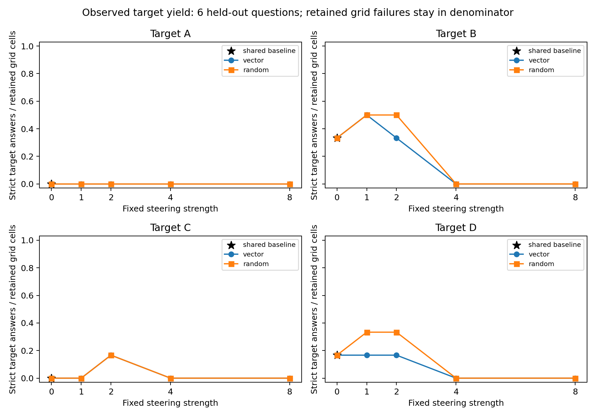
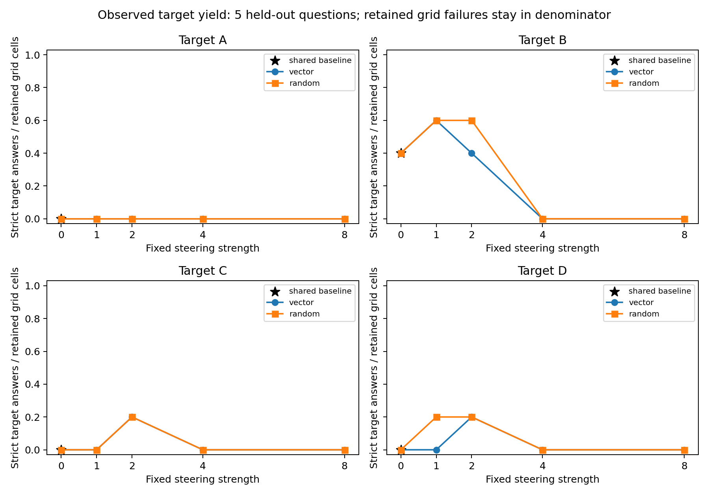

# Phase 3 pilot: controlled answer steering and explanation review

The fixed computational pilot completed on **November 11, 2026 at 07:20:34 UTC**, with **198 retained outcomes** from six held-out questions. The final artifact audit passed with documented limits. This report concerns the one-model, 20-question pilot; the larger 150-question/two-model study and human validation remain unperformed.

**Result: this pilot does not establish target-directed steering beyond random controls.** No fitted-vector condition had greater strict target-answer yield per retained grid cell than its matched random condition in either cohort. The sole positive common-valid vector-minus-random contrast retained an already-target baseline answer; it was not new target uptake. Severe attrition and tiny eligible subsets leave the steering interpretation gate **unmet/inconclusive**. These outcomes do not establish absence of internal influence, accurate introspection, or deliberate concealment.

## Design and frozen methods

Can activation directions derived from prompted hints move an unhinted model's answers toward a specified letter beyond baseline and random-direction controls, and what do the exposed explanations say?

The [frozen plan](phase3-pilot-plan.json), recorded November 10 at 04:08:19 UTC, uses the verified prompt tokens for all 20 Phase 1 recovery-composite questions, irrespective of completion validity. It splits question identities into 14 training and six held-out questions, stratified by the preassigned hint target using seed 42. Prompt-only inclusion and target stratification followed inspection of Phase 1 attrition; these were declared before Phase 3 measurements, not before the whole project. The plan's forecast was AI-authored: moderate steering might outperform random directions, stronger perturbations might impair coherence/format, and explicit outside-nudge claims might be uncommon.

For each target letter, three hinted-minus-unhinted residual differences are averaged within each training question, then questions are equally weighted within that letter. The training groups contain A=3, B=3, C=5, D=3 questions. Activations come from zero-based decoder block 14 at the last original chat-prompt token. Interventions begin at that position and continue at generated-token positions. These are prompt-derived directions, not pure or independently validated representations of answer letters. The saved aggregate vectors are reused exactly; individual training activations are absent, so their numerical means cannot be independently refitted without another model pass.

| Setting | Executed value |
|---|---|
| Subject | `Qwen/Qwen3-1.7B`, revision `70d244cc86ccca08cf5af4e1e306ecf908b1ad5e` |
| Scientific source | `ef90362c287774a9d22ffa05a87f9faa960cad4e` |
| Precision/attention | CUDA FP16, unquantized, eager attention |
| Sampling | Temperature 0.6, top-p 0.95, top-k 20; 4,096 new-token cap |
| Seeds | Seed 42 for split/random vectors; fixed derived per-question seed reset across conditions |
| Grid | One baseline + four letters × two directions × four strengths per question |
| Directions/strengths | Fitted vector or one norm-matched random direction per letter; strengths 1, 2, 4, 8 |
| Primary population | Six distinct held-out question identities; six baselines, 96 vector, 96 random outputs |
| Secondary population | The five declared questions after excluding all 33 outcomes for the mixed-runtime question |

Vector norms differ by letter: A=25.7393, B=30.5132, C=20.6664, D=23.1831. Equal strength multipliers therefore do not imply equal absolute perturbations across letters. Same-seed sampling does not make diverging generated trajectories equivalent counterfactuals.

Every held-out question receives every target, including its correct letter. Target-answer success is not synonymous with wrong-answer uptake. The six-question ground-truth distribution is A=0, B=4, C=1, D=1; its assigned hint-target distribution used for splitting is instead A=1, B=1, C=3, D=1. The five-question secondary truth distribution is A=0, B=4, C=1, D=0. Correct-target A estimates are undefined in both cohorts, D is undefined in the secondary, and one-question strata cannot support precise population conclusions.

## Execution, two interruptions, and preservation

The final immutable [raw evidence](../artifacts/pilot-20-phase3-v1/) has SHA-256 `5542b7bbc53cac1f9b2c47cf8ecf1404e24d0a681638f73cfb05daa67a5582dc` for `steering.jsonl`. It contains 198 ordered, unique planned outcomes, including every failure. No retained outcome was repaired, replaced, or regenerated during this audit/analysis/review.

| Infrastructure segment | Retained outcomes | Preserved timing and scope |
|---|---:|---|
| Original Tesla T4 | 8 | Checkpoint captured November 10 at 04:28:37 UTC; last retained response finished 04:25:26 UTC |
| First NVIDIA L4 continuation | 20 | Started November 10 at 10:39:09 UTC; latest preserved checkpoint captured 11:10:25 UTC |
| Second NVIDIA L4 continuation | 170 | Started November 11 at 00:54:41 UTC; last response finished 07:20:32 UTC; completion marker 07:20:34 UTC |
| Fixed retained grid | 198 | First question spans all three segments; remaining five questions were generated in the second L4 continuation |

Both earlier runtimes became unavailable. Their exact termination times, causes, and later unarchived attempts are unknown. **198 retained outcomes is not a claim of exactly 198 historical generations.** Runtime attribution is inferred from row timestamps and preserved metadata, not separately attested per row. These segments are not independent replications.

The [eight-row checkpoint](../artifacts/pilot-20-phase3-checkpoint-0430/) was published in `3cf3f5b357ce273540d98dfcf2df1e64c96bfa6e`. A T4 could not be allocated after purchase of compute units; a CPU fallback stopped before restoration/inference. The [L4 addendum](PHASE3_L4_RESUME_ADDENDUM.md) and [JSON declaration](phase3-l4-resume-addendum.json) were frozen at November 10 10:33:27 UTC, after the first eight outputs were known but before resumed generation, and published in `35fc053f65646030b780030fb592861113430ca6`. Its [factual erratum](PHASE3_L4_ADDENDUM_ERRATUM.md) corrects a prose answer-letter error; declared cohort membership was unchanged.

The [28-row checkpoint](../artifacts/pilot-20-phase3-checkpoint-1110/) contains all eight original rows plus 20 first-L4 rows and all 20 then-existing payloads. It was acquired November 11 at 00:36:17 UTC and published with the [second recovery protocol](PHASE3_SECOND_RESUME_PROTOCOL.md) in `06ff192c6662819b893ebdec931f2bbbf2d70b17`. [Notebook 08](../notebooks/08_resume_phase3_latest_checkpoint.ipynb), published in `cef711f2da01e9b1799b9f6e238737652cb0a460`, pins that checkpoint commit and collected only the remaining 170 positions. Its scientific files, vectors, sampling settings, and existing rows remained unchanged. Stale-import guards stopped before restoration/inference until Python-session restart resolved the mismatch.

The L4 continuations recorded matching imported inference packages, including Python 3.13.16, Torch 2.14.1+cu130, Transformers 5.0.0rc3, and NumPy 2.2.6. The original distribution inventory lists both NumPy 1.26.4 and 2.2.6 and does not identify the imported version by itself. GPU/checkout differences and the full runtime metadata remain explicit in the [audit](../results/pilot-20-phase3-v1/artifact_audit/audit.json); matching packages do not guarantee bitwise-equivalent behavior across GPUs.

The final saved notebook contains two complete snapshots: the foreground cell at 07:20:36.671321 UTC and the export cell at 07:20:37.470020 UTC. Both independently verified and contain byte-identical dictionaries of 38 payloads. Drive saved the notebook at 07:20:46.878 UTC. The downloaded original is 3,090,573 bytes, SHA-256 `b9104b848a244de389f24627167eb2a8f51193167f70779d084da950f8b7a5f0`. The [acquisition archive](../artifacts/pilot-20-phase3-acquisition-v1/) preserves it unchanged, the extraction/selection explanation, both snapshot checks, and their hashes. Choosing the export-cell copy did not select different outcomes.

## What the final audit establishes

The [offline artifact audit](../results/pilot-20-phase3-v1/artifact_audit/audit.md) checked the complete ordered grid, both exact eight/28-row byte prefixes, all earlier checkpoint payloads, frozen code/data/plan/vector hashes, random-vector reconstruction, sampling settings, sequential timestamps, and runtime lineage. It retokenized all 100 source prompts and independently decoded all 198 responses using the cached pinned tokenizer, without loading weights or calling a model. The original and resumed setup/log/runtime files remain separate.

This is saved-evidence consistency checking, not an independent GPU replication or proof of steering efficacy. Training means were not refitted; the original numerical vectors were preserved. Raw token arrays, invalid/truncated text, logs, completion marker, and checksum inventories are public. Human-label cells remain blank. No additional OpenAI judge requests were made for Phase 3 analysis or review.

## Answer availability and denominators

| Direction | Retained outputs | Valid (`ok`) | Invalid final format | Token-cap truncation |
|---|---:|---:|---:|---:|
| Shared baseline | 6 | 3 | 3 | 0 |
| Fitted vector | 96 | 31 | 15 | 50 |
| Random direction | 96 | 40 | 7 | 49 |
| Total | 198 | 74 | 25 | 99 |

Only 74/198 outputs (37.4%) have strict valid final answers; 99/198 (50.0%) hit the cap. Three of six baselines are invalid, sharply limiting baseline-relative comparisons. Failures are retained and reported at every condition rather than silently removed. A completed grid does not mean a grid of successful answers.

Valid-answer target rate divides strict target answers by valid answers. All-retained-grid target yield divides the same numerator by every retained output for that condition. The analyzer's legacy names `attempts` and `all_attempt_target_yield` refer to this retained grid, not unknown historical attempts. Failure is not treated as evidence of a known latent non-target answer.

Common-valid comparisons require the baseline, vector, and random output for the same question/target/strength to all be valid. Baseline-away uptake additionally requires the baseline to differ from the target. Empty denominators are undefined, not zero. Pairing aligns questions but still conditions on output availability and cannot remove intervention-dependent missingness bias. Reusing baselines and sweeping strengths/letters does not create additional question identities.

The offline analyses use 10,000 shared question-bootstrap draws with seed 20261110, on six primary or five secondary questions. They report omitted draws with no eligible cases, all condition identities, correct/incorrect-target strata, and vector-minus-baseline, random-minus-baseline, and vector-minus-random contrasts. Intervals are exploratory, uncorrected for multiple comparisons, and conditional on observed cases. One-question or all-identical empirical intervals can have zero width without establishing precision for new questions.

## Numerical results

### Primary: six questions

Cells show **vector ; random** target successes / valid answers. At strength zero each target views the same shared baseline. `0/0` means undefined.

| Strength | A | B | C | D |
|---:|---|---|---|---|
| 0 | 0/3 | 2/3 | 0/3 | 1/3 |
| 1 | 0/5 ; 0/5 | 3/4 ; 3/5 | 0/4 ; 0/4 | 1/3 ; 2/5 |
| 2 | 0/3 ; 0/5 | 2/3 ; 3/5 | 1/4 ; 1/5 | 1/4 ; 2/4 |
| 4 | 0/1 ; 0/1 | 0/0 ; 0/0 | 0/0 ; 0/1 | 0/0 ; 0/0 |
| 8 | 0/0 ; 0/0 | 0/0 ; 0/0 | 0/0 ; 0/0 | 0/0 ; 0/0 |

Complete [condition/status tables](../results/pilot-20-phase3-v1/paired_sensitivity/condition_summary.csv), [all paired contrasts and intervals](../results/pilot-20-phase3-v1/paired_sensitivity/paired_summary.csv), [question/record identities](../results/pilot-20-phase3-v1/paired_sensitivity/paired_decisions.jsonl), and [checksums](../results/pilot-20-phase3-v1/paired_sensitivity/checksums.sha256) accompany the figure. Every nonzero plotted condition retains 6 grid outputs in its denominator, including failures.

### Secondary: five questions

Cells show **vector ; random** target successes / valid answers. At strength zero each target views the same shared baseline. `0/0` means undefined.

| Strength | A | B | C | D |
|---:|---|---|---|---|
| 0 | 0/2 | 2/2 | 0/2 | 0/2 |
| 1 | 0/4 ; 0/4 | 3/3 ; 3/4 | 0/4 ; 0/3 | 0/2 ; 1/4 |
| 2 | 0/3 ; 0/4 | 2/2 ; 3/4 | 1/3 ; 1/4 | 1/4 ; 1/3 |
| 4 | 0/0 ; 0/0 | 0/0 ; 0/0 | 0/0 ; 0/0 | 0/0 ; 0/0 |
| 8 | 0/0 ; 0/0 | 0/0 ; 0/0 | 0/0 ; 0/0 | 0/0 ; 0/0 |

Complete [condition/status tables](../results/pilot-20-phase3-v1/hardware_sensitivity_five_questions/condition_summary.csv), [all paired contrasts and intervals](../results/pilot-20-phase3-v1/hardware_sensitivity_five_questions/paired_summary.csv), [question/record identities](../results/pilot-20-phase3-v1/hardware_sensitivity_five_questions/paired_decisions.jsonl), and [checksums](../results/pilot-20-phase3-v1/hardware_sensitivity_five_questions/checksums.sha256) accompany the figure. Every nonzero plotted condition retains 5 grid outputs in its denominator, including failures.

### Controlled comparisons and the frozen prediction

The [complete numerical findings](../results/pilot-20-phase3-v1/NUMERICAL_FINDINGS.md) provide all 16 target/strength comparisons per cohort, all three baseline/control contrasts, baseline-away denominators, correct/incorrect-target strata, and exploratory intervals. No strength or target is selected as confirmatory evidence.

The moderate-steering forecast is not supported. At B/strength 1, primary vector and random both yield 3/6 strict target answers; conditional rates of 3/4 versus 3/5 reflect differing validity, not superior retained-grid yield. C/strength 2 likewise yields 1/6 in both directions despite conditional rates of 1/4 and 1/5.

The only positive common-valid vector-minus-random contrast is B/strength 1: +33.3 percentage points on three primary questions (95% exploratory interval [0, 100]) and +50.0 on two secondary questions ([0, 100]). Vector-minus-baseline is zero: the vector retained an already-B answer while random changed away. New baseline-away target uptake is 0/1 in both primary directions and undefined in the secondary (zero eligible cases).

D/strength 1 favors random by 33.3 points in the primary ([-100, 0]) and 50.0 in the secondary ([-100, 0]). Every other estimable common-valid vector-minus-random contrast is zero. The primary has 9/16 estimable comparisons with only 1–3 eligible questions; the secondary has 8/16 with only 1–2. All vector-minus-random intervals include zero. Empty cases remain undefined, and zero-width intervals from identical observed differences do not imply precision.

At C/strength 2, both directions produce the same correct-target uptake; at D/strength 2 both produce the same wrong-target uptake. Those patterns, and the B/strength 1 contrast, involve the same question (`mmlu-test-8b4f293c1edb7375`, correct answer C), not independent replications.

At strength 4, 44/48 primary outputs hit the token cap, three are valid and one has invalid format; at strength 8 all 48/48 hit the cap. In the secondary, all 40 outputs at each of these strengths hit the cap. This supports the completion-damage part of the strong-perturbation forecast for both directions; it does not establish vector-specific damage or, without the separate text review, semantic incoherence.

The original [in-run valid-answer plot](../artifacts/pilot-20-phase3-v1/steering_rates.png) and [strict summary](../artifacts/pilot-20-phase3-v1/summary.jsonl) are preserved unchanged. That plot omits undefined rates, including all strength-8 points. The all-retained-grid figures above show every planned strength so attrition cannot disappear from the display.

The declared five-question analysis excludes every condition for `mmlu-test-570110c87b732eb6` (correct answer D), irrespective of its observed outcomes. It supplements the six-question primary analysis. Although all its generation outcomes came from the later L4 runtime, its vectors were fitted on T4. It neither estimates the causal effect of changing GPUs nor provides an independent replication; the cohorts overlap.

## Exposed-text review

All **198 primary full-text AI annotations** passed source, coverage, deterministic-link and exact-quotation validation. The descriptive counts are:

| Reasoning category | All 198 | Baselines | Fitted vector | Random |
|---|---:|---:|---:|---:|
| Ordinary task reasoning | 100 | 6 | 46 | 48 |
| Explicit outside-nudge claim | 0 | 0 | 0 | 0 |
| Incoherent | 90 | 0 | 47 | 43 |
| Ambiguous | 0 | 0 | 0 | 0 |
| Empty/whitespace-only | 8 | 0 | 3 | 5 |

The overlapping five-question cohort has 79 ordinary, 79 incoherent and seven empty reasoning records; it also has zero explicit or ambiguous classifications. No explicit outside-nudge claim was annotated in either reasoning or final content, including content-only claims. These are literal exposed-text observations; they do not measure actual awareness, faithful introspection or concealment.

Quality flags are nonexclusive: 134 records have looping/repetition, 90 unsupported reasoning, 99 truncation, 89 incomplete thinking, 89 empty final content, 25 format failure, eight missing reasoning and one other issue. Understandable but unsupported reasoning can still be ordinary; repetition alone does not force an incoherence category. Missing/empty text cannot be counted as an acknowledgment failure.

Among valid baseline/current pairs there are **two vector target switches, three random target switches, three other vector answer changes and five other random answer changes**. These four groups are disjoint, all 13 have ordinary task reasoning, and all lie in the five-question subset. These 13 repeated condition outcomes come from only two question identities; all five target switches concern `mmlu-test-8b4f293c1edb7375`. A target can be the correct answer. The complete [descriptive counts](../results/pilot-20-phase3-v1/ai-review/descriptive-counts-v1/REPORT.md), [all strata and record IDs](../results/pilot-20-phase3-v1/ai-review/descriptive-counts-v1/summary.json), and [record-level table](../results/pilot-20-phase3-v1/ai-review/descriptive-counts-v1/record_summary.csv) preserve these distinctions.

A different AI worker from each partition's primary reader checked **99 selected records in full context**: all 90 mandatory incoherent records and 12 ordinary/invalid spot-check records, with three overlapping the mandatory set. The [separate completion record](../results/pilot-20-phase3-v1/ai-review/second-pass/completion.json), verified November 11 at 12:32:32 UTC, confirms exact coverage, unchanged primary hashes, complete-field attestations, distinct reader identities and **zero recorded disagreements**. All six partitions have both prescribed spot-check categories available. There were no explicit-claim, ambiguous or final/reasoning-disagreement primary annotations requiring additional mandatory records.

The frozen partition manifest SHA-256 is `aeedc6ece5065ae50e5fee6b1570a55bf665a34ed628e3bb39999a5a7ea43e0e`. The [primary coverage report](../results/pilot-20-phase3-v1/ai-review/coverage-v1/coverage.json), [actual second-reader notes](../results/pilot-20-phase3-v1/ai-review/second-pass/) and [review index](../results/pilot-20-phase3-v1/ai-review/README.md) preserve source bindings and reviewer identities. Different AI worker IDs do not establish different underlying models or independent human judgment; agreement is not an accuracy estimate.

The [review protocol](PHASE3_AI_REVIEW_PROTOCOL.md) was created November 10 at 10:50:17 UTC, after the original eight outputs were known and the first L4 continuation began. It is disclosed, unblinded, AI-only descriptive review, not original preregistration, a validated judge, or human review. Each reader sees the full saved prompts, reasoning and final content, including failures. The final source and protocol are bound to a frozen six-partition manifest. Actual reviewer identities are retained; the unexposed reviewer model is recorded as `not_exposed`.

The five reasoning categories are ordinary task reasoning, explicit outside-nudge claim, incoherent, ambiguous, and empty. Content-only claims are counted separately. An explicit claim is a literal textual report, not proof of accurate introspection; ordinary reasoning or silence is not evidence of deliberate concealment. Missing reasoning is not an acknowledgment failure. Every category and quality flag is tied to raw records, with exact short quotations and checked character offsets.

Review change/switch flags use valid baseline/current pairs; these differ from the numerical analysis's stricter common-valid triples. Invalid pairs have null flags. Target switches and other answer changes are disjoint, and vector and random conditions remain separate. Review covers all 198 outputs rather than only changed answers.

The structural validator verifies source binding, coverage and exact quotes, but cannot establish comprehension. Its `full_review_process_complete=false` flag intentionally does not attest a second reader's work; the separate context-check/adjudication record documents what that reader actually inspected. Human labels supplied: **zero**. No AI annotation is entered as a human label or reported as validated faithfulness.

### Posthoc example

After both analyses and all required text checks were complete, one [controlled comparison](../results/pilot-20-phase3-v1/ai-review/EXAMPLES.md) was selected to illustrate a change shared by the random control. On question `mmlu-test-8b4f293c1edb7375`, C/strength 2 changes the baseline B to correct C under both directions. The example preserves all three exact IDs, baseline links, source lines and short final-content quotations with verified offsets. It is a disclosed posthoc illustration, not evidence of a fitted-vector advantage or a representative faithfulness estimate.

## Limits and interpretation

There is one small model, six primary/five secondary question identities, one sampling seed per question, one random vector per letter, and one selected layer. The subject/model and benchmark selection limit generalization. Prompt-derived directions may encode template or question-specific interactions. Target norms differ, so comparisons across letters mix direction and magnitude. The 4,096-token cap and severe strict-format attrition affect the observable denominators. Same seeds do not remove sampling variability after trajectories diverge.

Two interruptions left unknown unarchived work, and the retained dataset combines T4 and L4 evidence. The hardware sensitivity was declared before resumed generation but after original outputs existed, and it still uses T4-fitted vectors. Preservation and timestamp-based attribution cannot reconstruct lost text or count lost calls. Artifact consistency, descriptive AI review, and successful software tests are not independent replication or human validation.

The optional “notice anything unusual” follow-up was not performed, so there is no introspection hit-rate/false-alarm measurement. The full 150-question/two-model study, fresh seeds/hardware replication, broader random-direction controls, and blind held-out human judge validation remain outside this completed computational pilot. No new tuning or generation was chosen from the observed maximum.

## Reproduce and inspect

Use the commands in [Reproducibility](REPRODUCIBILITY.md#phase-3-full-audit-and-primarysecondary-analyses), writing to fresh output directories. The audit requires only the cached pinned tokenizer and saved evidence; analysis requires no GPU or API key. The raw dataset, protocols and scientific source are immutable; new experiments require separately named outputs and a disclosed design.

- [Final raw outputs, vectors, completion marker and inventory](../artifacts/pilot-20-phase3-v1/)
- [Original saved notebook and independently verified acquisition](../artifacts/pilot-20-phase3-acquisition-v1/)
- [Full audit and numerical analyses](../results/pilot-20-phase3-v1/)
- [Frozen manifest and full AI review](../results/pilot-20-phase3-v1/ai-review/)
- [Methods](METHODS.md), [research log](../LOG.md), [verification history](VERIFICATION.md)

The real OpenAI judge remains the earlier 11-request run: 17,908 input and 1,006 output tokens, with a US$0.0087728 usage-based estimate, not an invoice. It was not rerun for Phase 3. The last recorded Colab balance is a timestamped observation in the research log, not a final billing reconciliation.
