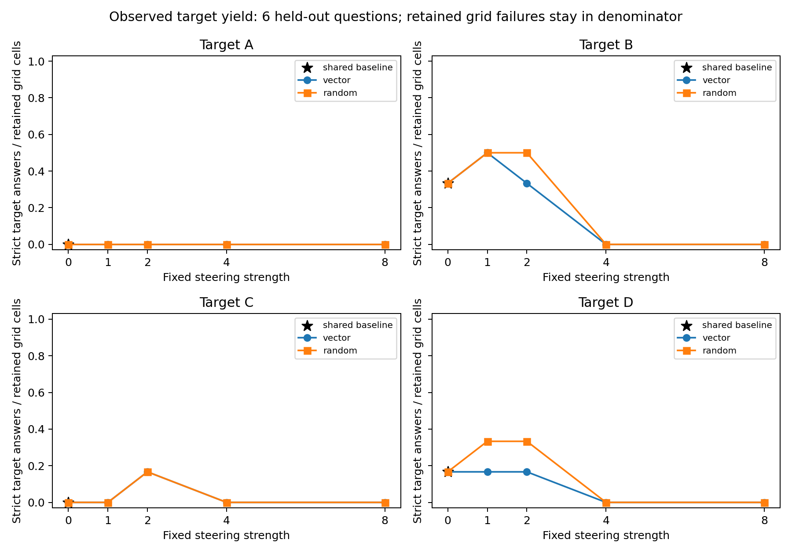
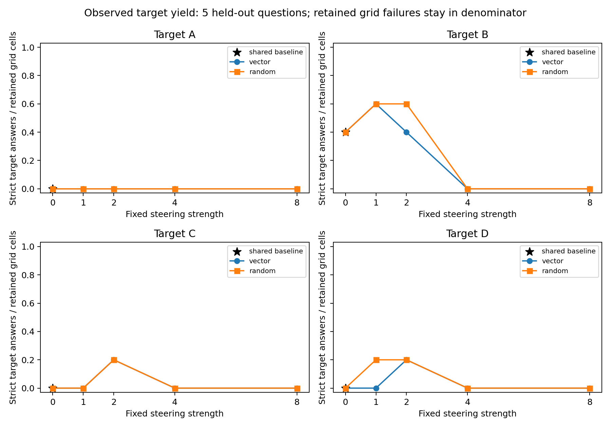

# Phase 3 numerical findings

**The pilot does not establish target-directed steering beyond the random controls.** No vector condition has a larger strict target-answer yield per retained grid cell than its matched random condition in either cohort. Severe attrition and only one to three eligible primary questions per estimable comparison leave the steering interpretation gate unmet/inconclusive. This is not proof that internal activations were unaffected, and it supplies no faithfulness or concealment estimate.

Raw source: [198 retained outcomes](../../artifacts/pilot-20-phase3-v1/steering.jsonl), SHA-256 `5542b7bbc53cac1f9b2c47cf8ecf1404e24d0a681638f73cfb05daa67a5582dc`. The [independent artifact audit](artifact_audit/audit.json) passed exact token/text, frozen-source and both checkpoint-prefix checks. Retained lineage is eight T4 +20 first-L4 +170 second-L4 outputs. Unknown unarchived attempts after both interruptions are not a measurable denominator.

Analysis checkout: `147a115455ffb2d6590d802afc2a9399993b339b`. The unchanged [offline analyzer](../../scripts/analyze_phase3_pilot.py) ran with 10,000 shared question-bootstrap draws, seed 20261110; exact code/input hashes are in the [primary provenance](paired_sensitivity/provenance.json) and [secondary provenance](hardware_sensitivity_five_questions/provenance.json). No new inference, API request or explanation label was produced for this analysis.

## Supported findings and prediction assessment

- The moderate-steering prediction is not supported by these outcomes. At B/strength 1, primary vector and random both yielded 3/6 strict target answers; conditioning on valid answers gives 3/4 versus 3/5, which is not a retained-yield advantage. C/strength 2 likewise gives 1/6 in both directions despite conditional rates of 1/4 versus 1/5.
- The only positive common-valid vector-minus-random contrast is B/strength 1: +33.3 percentage points on three primary questions (95% exploratory interval [0, 100]) and +50.0 on two secondary questions ([0, 100]). Vector-minus-baseline is zero. The difference comes from preserving an already-B baseline while random changed away; it is not new target uptake. Baseline-away uptake is 0/1 in both primary directions and undefined in the secondary cohort (no eligible baseline-away question).
- D/strength 1 favors random over vector by 33.3 points on three primary questions ([-100, 0]) and 50.0 on two secondary questions ([-100, 0]). Every other estimable vector-minus-random common-valid contrast is zero; unestimable contrasts stay undefined. All estimable vector-minus-random intervals include zero, and these small, discrete bootstrap intervals are not significance tests.
- Higher strength strongly degraded completion under both directions: at strength 4, 44/48 primary outputs were truncated, three were valid and one had invalid final format; at strength 8 all 48/48 were truncated. In the secondary cohort, all 40/40 outputs at each of strengths 4 and 8 were truncated. This supports the token-limit/completion part of the strong-perturbation prediction, not a vector-specific damage effect or a claim about semantic coherence.
- The prediction about explicit outside-nudge reports remains for full AI trace review. These numerical analyses do not inspect or classify explanation content. No human labels or validated judge are supplied.

## Retained-output status counts

Each row below counts actual retained records once; baseline target views are not multiplied. `ok` is the only observed answer-valid status here; `missing_reasoning` and request-error counts are zero.

| Cohort | Direction | Retained | Valid (`ok`) | Invalid final answer | Truncated |
|---|---|---:|---:|---:|---:|
| Primary | baseline | 6 | 3 | 3 | 0 |
| Primary | vector | 96 | 31 | 15 | 50 |
| Primary | random | 96 | 40 | 7 | 49 |
| Primary | all | 198 | 74 | 25 | 99 |
| Secondary | baseline | 5 | 2 | 3 | 0 |
| Secondary | vector | 80 | 25 | 11 | 44 |
| Secondary | random | 80 | 30 | 7 | 43 |
| Secondary | all | 165 | 57 | 21 | 87 |

Status counts describe attrition, not 198 independent statistical observations. Primary validity is 74/198 (37.4%); secondary validity is 57/165 (34.5%). Only 3/6 primary baselines and 2/5 secondary baselines have valid answers, which sharply restricts paired eligibility.

## Primary: six questions

Sources: [condition table](paired_sensitivity/condition_summary.csv), [paired table](paired_sensitivity/paired_summary.csv), [per-question decisions](paired_sensitivity/paired_decisions.jsonl), [analysis report](paired_sensitivity/REPORT.md), [checksums](paired_sensitivity/checksums.sha256).

### Marginal strict target successes / valid answers

Each nonzero cell is **vector ; random**. Strength zero is the same shared baseline shown once for each target, not separately generated vector/random baselines. `0/0` is undefined, never a zero conditional rate.

| Strength | Target A | Target B | Target C | Target D |
|---:|---|---|---|---|
| 0 | 0/3 | 2/3 | 0/3 | 1/3 |
| 1 | 0/5 ; 0/5 | 3/4 ; 3/5 | 0/4 ; 0/4 | 1/3 ; 2/5 |
| 2 | 0/3 ; 0/5 | 2/3 ; 3/5 | 1/4 ; 1/5 | 1/4 ; 2/4 |
| 4 | 0/1 ; 0/1 | 0/0 (undefined) ; 0/0 (undefined) | 0/0 (undefined) ; 0/1 | 0/0 (undefined) ; 0/0 (undefined) |
| 8 | 0/0 (undefined) ; 0/0 (undefined) | 0/0 (undefined) ; 0/0 (undefined) | 0/0 (undefined) ; 0/0 (undefined) | 0/0 (undefined) ; 0/0 (undefined) |

### Strict target successes / all retained grid cells

Each direction has 6 retained outcomes at every target and nonzero strength. Failures stay in this denominator. These observed yields do not assign latent answers to failed outputs or count lost historical attempts. Cells again show **vector ; random**, with one shared baseline at zero.

| Strength | Target A | Target B | Target C | Target D |
|---:|---|---|---|---|
| 0 | 0/6 | 2/6 | 0/6 | 1/6 |
| 1 | 0/6 ; 0/6 | 3/6 ; 3/6 | 0/6 ; 0/6 | 1/6 ; 2/6 |
| 2 | 0/6 ; 0/6 | 2/6 ; 3/6 | 1/6 ; 1/6 | 1/6 ; 2/6 |
| 4 | 0/6 ; 0/6 | 0/6 ; 0/6 | 0/6 ; 0/6 | 0/6 ; 0/6 |
| 8 | 0/6 ; 0/6 | 0/6 ; 0/6 | 0/6 ; 0/6 | 0/6 ; 0/6 |

### Common-valid paired contrasts and baseline-away uptake

V=vector, R=random, B=baseline. Each contrast is a target-indicator difference in **percentage points**, followed by its 95% exploratory question-bootstrap interval. `N` requires valid B/V/R for the same question; `away` additionally requires B to answer away from the target. Uptake cells are **V successes/away ; R successes/away**. The final contrast uses only the away subset. No eligible question means undefined.

| Target | Strength | N | away | V−B [95% CI] | R−B [95% CI] | V−R [95% CI] | Uptake V ; R | Uptake V−R [95% CI] |
|---|---:|---:|---:|---|---|---|---|---|
| A | 1 | 3 | 3 | +0.0 [+0.0, +0.0] | +0.0 [+0.0, +0.0] | +0.0 [+0.0, +0.0] | 0/3 ; 0/3 | +0.0 [+0.0, +0.0] |
| A | 2 | 2 | 2 | +0.0 [+0.0, +0.0] | +0.0 [+0.0, +0.0] | +0.0 [+0.0, +0.0] | 0/2 ; 0/2 | +0.0 [+0.0, +0.0] |
| A | 4 | 1 | 1 | +0.0 [+0.0, +0.0] | +0.0 [+0.0, +0.0] | +0.0 [+0.0, +0.0] | 0/1 ; 0/1 | +0.0 [+0.0, +0.0] |
| A | 8 | 0 | 0 | undefined | undefined | undefined | 0/0 (undefined) ; 0/0 (undefined) | undefined |
| B | 1 | 3 | 1 | +0.0 [+0.0, +0.0] | -33.3 [-100.0, +0.0] | +33.3 [+0.0, +100.0] | 0/1 ; 0/1 | +0.0 [+0.0, +0.0] |
| B | 2 | 2 | 1 | +0.0 [+0.0, +0.0] | +0.0 [+0.0, +0.0] | +0.0 [+0.0, +0.0] | 0/1 ; 0/1 | +0.0 [+0.0, +0.0] |
| B | 4 | 0 | 0 | undefined | undefined | undefined | 0/0 (undefined) ; 0/0 (undefined) | undefined |
| B | 8 | 0 | 0 | undefined | undefined | undefined | 0/0 (undefined) ; 0/0 (undefined) | undefined |
| C | 1 | 2 | 2 | +0.0 [+0.0, +0.0] | +0.0 [+0.0, +0.0] | +0.0 [+0.0, +0.0] | 0/2 ; 0/2 | +0.0 [+0.0, +0.0] |
| C | 2 | 3 | 3 | +33.3 [+0.0, +100.0] | +33.3 [+0.0, +100.0] | +0.0 [+0.0, +0.0] | 1/3 ; 1/3 | +0.0 [+0.0, +0.0] |
| C | 4 | 0 | 0 | undefined | undefined | undefined | 0/0 (undefined) ; 0/0 (undefined) | undefined |
| C | 8 | 0 | 0 | undefined | undefined | undefined | 0/0 (undefined) ; 0/0 (undefined) | undefined |
| D | 1 | 3 | 2 | +0.0 [+0.0, +0.0] | +33.3 [+0.0, +100.0] | -33.3 [-100.0, +0.0] | 0/2 ; 1/2 | -50.0 [-100.0, +0.0] |
| D | 2 | 2 | 2 | +50.0 [+0.0, +100.0] | +50.0 [+0.0, +100.0] | +0.0 [+0.0, +0.0] | 1/2 ; 1/2 | +0.0 [+0.0, +0.0] |
| D | 4 | 0 | 0 | undefined | undefined | undefined | 0/0 (undefined) ; 0/0 (undefined) | undefined |
| D | 8 | 0 | 0 | undefined | undefined | undefined | 0/0 (undefined) ; 0/0 (undefined) | undefined |

9/16 contrasts have any common-valid question; their effective bootstrap draws range from 6,714 to 9,833 of 10,000. The linked paired table records exact omitted-draw counts and question IDs for every condition and stratum. Point intervals at zero reflect resampling identical observed differences, not certainty about a larger population.

## Secondary: five questions

Sources: [condition table](hardware_sensitivity_five_questions/condition_summary.csv), [paired table](hardware_sensitivity_five_questions/paired_summary.csv), [per-question decisions](hardware_sensitivity_five_questions/paired_decisions.jsonl), [analysis report](hardware_sensitivity_five_questions/REPORT.md), [checksums](hardware_sensitivity_five_questions/checksums.sha256).

### Marginal strict target successes / valid answers

Each nonzero cell is **vector ; random**. Strength zero is the same shared baseline shown once for each target, not separately generated vector/random baselines. `0/0` is undefined, never a zero conditional rate.

| Strength | Target A | Target B | Target C | Target D |
|---:|---|---|---|---|
| 0 | 0/2 | 2/2 | 0/2 | 0/2 |
| 1 | 0/4 ; 0/4 | 3/3 ; 3/4 | 0/4 ; 0/3 | 0/2 ; 1/4 |
| 2 | 0/3 ; 0/4 | 2/2 ; 3/4 | 1/3 ; 1/4 | 1/4 ; 1/3 |
| 4 | 0/0 (undefined) ; 0/0 (undefined) | 0/0 (undefined) ; 0/0 (undefined) | 0/0 (undefined) ; 0/0 (undefined) | 0/0 (undefined) ; 0/0 (undefined) |
| 8 | 0/0 (undefined) ; 0/0 (undefined) | 0/0 (undefined) ; 0/0 (undefined) | 0/0 (undefined) ; 0/0 (undefined) | 0/0 (undefined) ; 0/0 (undefined) |

### Strict target successes / all retained grid cells

Each direction has 5 retained outcomes at every target and nonzero strength. Failures stay in this denominator. These observed yields do not assign latent answers to failed outputs or count lost historical attempts. Cells again show **vector ; random**, with one shared baseline at zero.

| Strength | Target A | Target B | Target C | Target D |
|---:|---|---|---|---|
| 0 | 0/5 | 2/5 | 0/5 | 0/5 |
| 1 | 0/5 ; 0/5 | 3/5 ; 3/5 | 0/5 ; 0/5 | 0/5 ; 1/5 |
| 2 | 0/5 ; 0/5 | 2/5 ; 3/5 | 1/5 ; 1/5 | 1/5 ; 1/5 |
| 4 | 0/5 ; 0/5 | 0/5 ; 0/5 | 0/5 ; 0/5 | 0/5 ; 0/5 |
| 8 | 0/5 ; 0/5 | 0/5 ; 0/5 | 0/5 ; 0/5 | 0/5 ; 0/5 |

### Common-valid paired contrasts and baseline-away uptake

V=vector, R=random, B=baseline. Each contrast is a target-indicator difference in **percentage points**, followed by its 95% exploratory question-bootstrap interval. `N` requires valid B/V/R for the same question; `away` additionally requires B to answer away from the target. Uptake cells are **V successes/away ; R successes/away**. The final contrast uses only the away subset. No eligible question means undefined.

| Target | Strength | N | away | V−B [95% CI] | R−B [95% CI] | V−R [95% CI] | Uptake V ; R | Uptake V−R [95% CI] |
|---|---:|---:|---:|---|---|---|---|---|
| A | 1 | 2 | 2 | +0.0 [+0.0, +0.0] | +0.0 [+0.0, +0.0] | +0.0 [+0.0, +0.0] | 0/2 ; 0/2 | +0.0 [+0.0, +0.0] |
| A | 2 | 2 | 2 | +0.0 [+0.0, +0.0] | +0.0 [+0.0, +0.0] | +0.0 [+0.0, +0.0] | 0/2 ; 0/2 | +0.0 [+0.0, +0.0] |
| A | 4 | 0 | 0 | undefined | undefined | undefined | 0/0 (undefined) ; 0/0 (undefined) | undefined |
| A | 8 | 0 | 0 | undefined | undefined | undefined | 0/0 (undefined) ; 0/0 (undefined) | undefined |
| B | 1 | 2 | 0 | +0.0 [+0.0, +0.0] | -50.0 [-100.0, +0.0] | +50.0 [+0.0, +100.0] | 0/0 (undefined) ; 0/0 (undefined) | undefined |
| B | 2 | 1 | 0 | +0.0 [+0.0, +0.0] | +0.0 [+0.0, +0.0] | +0.0 [+0.0, +0.0] | 0/0 (undefined) ; 0/0 (undefined) | undefined |
| B | 4 | 0 | 0 | undefined | undefined | undefined | 0/0 (undefined) ; 0/0 (undefined) | undefined |
| B | 8 | 0 | 0 | undefined | undefined | undefined | 0/0 (undefined) ; 0/0 (undefined) | undefined |
| C | 1 | 2 | 2 | +0.0 [+0.0, +0.0] | +0.0 [+0.0, +0.0] | +0.0 [+0.0, +0.0] | 0/2 ; 0/2 | +0.0 [+0.0, +0.0] |
| C | 2 | 2 | 2 | +50.0 [+0.0, +100.0] | +50.0 [+0.0, +100.0] | +0.0 [+0.0, +0.0] | 1/2 ; 1/2 | +0.0 [+0.0, +0.0] |
| C | 4 | 0 | 0 | undefined | undefined | undefined | 0/0 (undefined) ; 0/0 (undefined) | undefined |
| C | 8 | 0 | 0 | undefined | undefined | undefined | 0/0 (undefined) ; 0/0 (undefined) | undefined |
| D | 1 | 2 | 2 | +0.0 [+0.0, +0.0] | +50.0 [+0.0, +100.0] | -50.0 [-100.0, +0.0] | 0/2 ; 1/2 | -50.0 [-100.0, +0.0] |
| D | 2 | 2 | 2 | +50.0 [+0.0, +100.0] | +50.0 [+0.0, +100.0] | +0.0 [+0.0, +0.0] | 1/2 ; 1/2 | +0.0 [+0.0, +0.0] |
| D | 4 | 0 | 0 | undefined | undefined | undefined | 0/0 (undefined) ; 0/0 (undefined) | undefined |
| D | 8 | 0 | 0 | undefined | undefined | undefined | 0/0 (undefined) ; 0/0 (undefined) | undefined |

8/16 contrasts have any common-valid question; their effective bootstrap draws range from 6,641 to 9,200 of 10,000. The linked paired table records exact omitted-draw counts and question IDs for every condition and stratum. Point intervals at zero reflect resampling identical observed differences, not certainty about a larger population.

## Correct-target and incorrect-target interpretation

The [frozen source](../../artifacts/pilot-20-qwen3-1.7b/recovery-composite/responses.jsonl) supplies ground-truth labels. Correct-target question counts are A=0/B=4/C=1/D=1 in the primary cohort and A=0/B=4/C=1/D=0 in the secondary. The corresponding incorrect-target counts are A=6/B=2/C=5/D=5 and A=5/B=1/C=4/D=5. These are design denominators before output attrition, not observed success counts. Empty correct-target strata and post-attrition empty cells remain undefined.

All correct/incorrect-target condition and paired results are in the linked CSV/JSON tables. Their counts must not be pooled into a generic wrong-answer-steering rate: at C/strength 2 the shared vector/random uptake moves to the correct C answer; at D/strength 2 the shared uptake moves to an incorrect D answer. The positive B/strength 1 paired difference preserves a baseline that was already the incorrect B, while random moves away. These nonzero paired patterns all involve the same held-out question, `mmlu-test-8b4f293c1edb7375` (correct answer C), rather than independent replications. Exact baseline/vector/random record IDs are in the [primary per-question decisions](paired_sensitivity/paired_decisions.jsonl).

## Limits and verification

The primary comparison has six question clusters, the secondary five overlapping clusters, one seed per question, one random direction per letter, and a single chosen layer. Correct-target C/D have at most one question. Common-valid comparisons condition on successful outputs; they do not correct differential failure or recover invalid baselines. The secondary excludes the predeclared mixed-runtime first question but still reuses T4-fitted vectors, so it neither estimates a causal GPU effect nor constitutes independent replication. No best strength, target or cohort is selected as confirmatory evidence.

The analysis ran only after the full artifact audit passed. An independent direct recomputation from immutable raw metadata checked all 108 condition rows and all 48 paired-row denominators, target counts and point differences for each cohort, including correct/incorrect-target strata; every generated file checksum passed. Both figures were visually inspected against the tabulated yields. Confidence intervals are the frozen analyzer’s shared-resample outputs; the small-sample/selection limitations above still apply. Raw source SHA-256 was rechecked unchanged.

The steering interpretation gate is **unmet/inconclusive**. The data support poor completion at high strengths and no consistent target-yield advantage over random controls. They do not establish absence of internal influence, reliable introspection, hidden reasoning or deliberate concealment. Explanation-category findings require the separately documented full AI reading and second-pass context checks; human validation remains absent.
