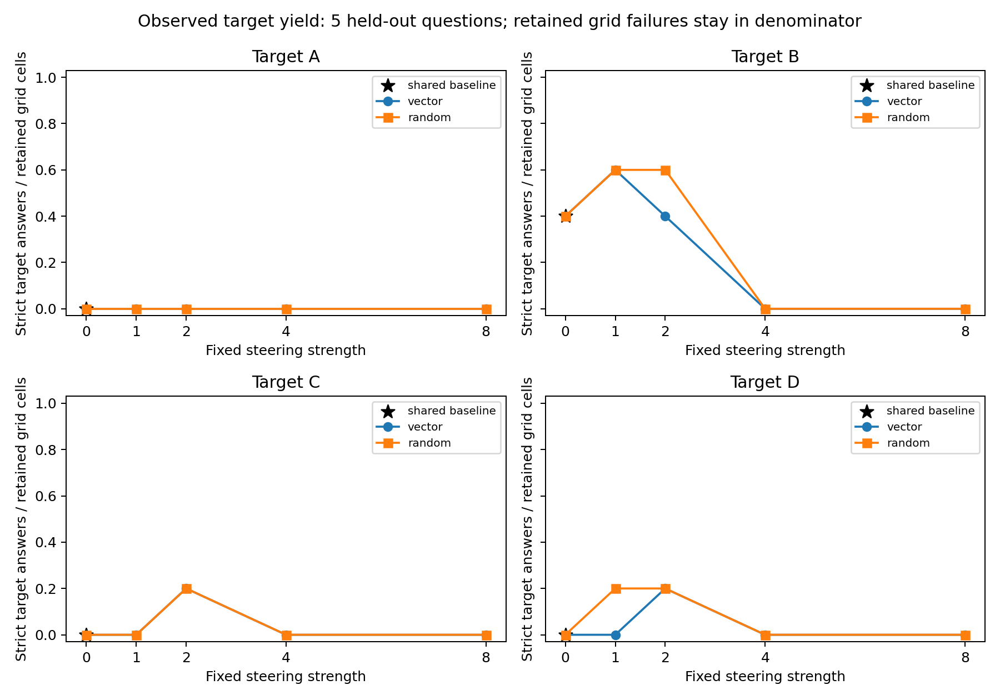

# Secondary Phase 3 hardware sensitivity

This secondary analysis was declared at 2026-11-10T10:33:27+00:00, before the first resumed generation. It excludes every condition of the single mixed T4/L4 question mmlu-test-570110c87b732eb6, including its baseline. The six-question/198-outcome primary analysis remains unchanged and is not replaced by this sensitivity.

The five retained questions were generated on L4 according to checkpoint membership and runtime timestamps; per-row runtime IDs are absent. All steering vectors were fitted on T4 and reused unchanged. This subset does not isolate a causal hardware effect, independently validate those vectors on L4, or provide human validation.

Correct-answer counts: A=0, B=4, C=1, D=0. Empty correct-target strata remain undefined; single-question intervals cannot establish population precision.

This additional analysis preserves the original strict parser, statuses, summary and figure. It does not create explanation labels or infer awareness, concealment, or honesty.

There are 5 held-out question clusters and 165 retained grid outcomes. The total number of historical generation attempts is unknown after a runtime loss. The same 5 retained baseline outcomes appear as four target views; those views are not independent attempts. Every fixed strength is shown, with no selection of a best strength. Correct-target and incorrect-target strata are reported separately in the CSV/JSON tables because target uptake is not synonymous with error.

All-attempt target yield counts valid strict target answers divided by retained outcomes in the fixed planned grid. The machine-readable attempts fields also count retained grid outcomes. Unknown lost attempts have no measurable denominator here and are not included in these rates. Invalid/truncated outputs remain in that denominator; this is observed yield, not evidence that their unobserved answer would be wrong. Status missing_reasoning remains answer-valid, as in the primary analysis. Valid-target rates condition on parseable, nontruncated answers.

Paired contrasts use the same question's valid baseline, vector and random outcomes. Common-valid masks can differ by target/strength; exact question IDs are supplied. Target uptake additionally requires baseline away from target. No eligible questions gives undefined, never zero.

Intervals are exploratory 95% percentile bootstrap intervals using one shared bank of 5-question cluster resamples across conditions. Zero-eligible draws are omitted and their counts/fractions reported. Intervals condition on observed complete cases, do not address missing-outcome bias, and have very limited resolution with 5 questions. One-question point intervals provide no population precision. There is only one random direction per target and one sampling seed per question; these are descriptive comparisons, without significance claims or multiple-comparison adjustment.

## All 5 held-out questions

| Target | Strength | Direction | Retained grid cells | Valid | Target | Valid target rate | All-attempt yield | Status counts |
| --- | ---: | --- | ---: | ---: | ---: | ---: | ---: | --- |
| A | 0 | baseline | 5 | 2 | 0 | 0.000 | 0.000 | {"invalid_answer": 3, "ok": 2} |
| A | 1 | vector | 5 | 4 | 0 | 0.000 | 0.000 | {"invalid_answer": 1, "ok": 4} |
| A | 1 | random | 5 | 4 | 0 | 0.000 | 0.000 | {"invalid_answer": 1, "ok": 4} |
| A | 2 | vector | 5 | 3 | 0 | 0.000 | 0.000 | {"invalid_answer": 2, "ok": 3} |
| A | 2 | random | 5 | 4 | 0 | 0.000 | 0.000 | {"invalid_answer": 1, "ok": 4} |
| A | 4 | vector | 5 | 0 | 0 | undefined | 0.000 | {"truncated": 5} |
| A | 4 | random | 5 | 0 | 0 | undefined | 0.000 | {"truncated": 5} |
| A | 8 | vector | 5 | 0 | 0 | undefined | 0.000 | {"truncated": 5} |
| A | 8 | random | 5 | 0 | 0 | undefined | 0.000 | {"truncated": 5} |
| B | 0 | baseline | 5 | 2 | 2 | 1.000 | 0.400 | {"invalid_answer": 3, "ok": 2} |
| B | 1 | vector | 5 | 3 | 3 | 1.000 | 0.600 | {"invalid_answer": 2, "ok": 3} |
| B | 1 | random | 5 | 4 | 3 | 0.750 | 0.600 | {"invalid_answer": 1, "ok": 4} |
| B | 2 | vector | 5 | 2 | 2 | 1.000 | 0.400 | {"ok": 2, "truncated": 3} |
| B | 2 | random | 5 | 4 | 3 | 0.750 | 0.600 | {"ok": 4, "truncated": 1} |
| B | 4 | vector | 5 | 0 | 0 | undefined | 0.000 | {"truncated": 5} |
| B | 4 | random | 5 | 0 | 0 | undefined | 0.000 | {"truncated": 5} |
| B | 8 | vector | 5 | 0 | 0 | undefined | 0.000 | {"truncated": 5} |
| B | 8 | random | 5 | 0 | 0 | undefined | 0.000 | {"truncated": 5} |
| C | 0 | baseline | 5 | 2 | 0 | 0.000 | 0.000 | {"invalid_answer": 3, "ok": 2} |
| C | 1 | vector | 5 | 4 | 0 | 0.000 | 0.000 | {"invalid_answer": 1, "ok": 4} |
| C | 1 | random | 5 | 3 | 0 | 0.000 | 0.000 | {"invalid_answer": 2, "ok": 3} |
| C | 2 | vector | 5 | 3 | 1 | 0.333 | 0.200 | {"invalid_answer": 1, "ok": 3, "truncated": 1} |
| C | 2 | random | 5 | 4 | 1 | 0.250 | 0.200 | {"ok": 4, "truncated": 1} |
| C | 4 | vector | 5 | 0 | 0 | undefined | 0.000 | {"truncated": 5} |
| C | 4 | random | 5 | 0 | 0 | undefined | 0.000 | {"truncated": 5} |
| C | 8 | vector | 5 | 0 | 0 | undefined | 0.000 | {"truncated": 5} |
| C | 8 | random | 5 | 0 | 0 | undefined | 0.000 | {"truncated": 5} |
| D | 0 | baseline | 5 | 2 | 0 | 0.000 | 0.000 | {"invalid_answer": 3, "ok": 2} |
| D | 1 | vector | 5 | 2 | 0 | 0.000 | 0.000 | {"invalid_answer": 3, "ok": 2} |
| D | 1 | random | 5 | 4 | 1 | 0.250 | 0.200 | {"invalid_answer": 1, "ok": 4} |
| D | 2 | vector | 5 | 4 | 1 | 0.250 | 0.200 | {"invalid_answer": 1, "ok": 4} |
| D | 2 | random | 5 | 3 | 1 | 0.333 | 0.200 | {"invalid_answer": 1, "ok": 3, "truncated": 1} |
| D | 4 | vector | 5 | 0 | 0 | undefined | 0.000 | {"truncated": 5} |
| D | 4 | random | 5 | 0 | 0 | undefined | 0.000 | {"truncated": 5} |
| D | 8 | vector | 5 | 0 | 0 | undefined | 0.000 | {"truncated": 5} |
| D | 8 | random | 5 | 0 | 0 | undefined | 0.000 | {"truncated": 5} |

## Common-valid paired comparisons

| Target | Strength | Common valid | Baseline away | Vector uptake (baseline away) | Random uptake (baseline away) | Target-rate difference (all common-valid): vector − random | 95% bootstrap interval |
| --- | ---: | ---: | ---: | ---: | ---: | ---: | --- |
| A | 1 | 2 | 2 | 0.000 | 0.000 | 0.000 | [0.000, 0.000] |
| A | 2 | 2 | 2 | 0.000 | 0.000 | 0.000 | [0.000, 0.000] |
| A | 4 | 0 | 0 | undefined | undefined | undefined | [undefined, undefined] |
| A | 8 | 0 | 0 | undefined | undefined | undefined | [undefined, undefined] |
| B | 1 | 2 | 0 | undefined | undefined | 0.500 | [0.000, 1.000] |
| B | 2 | 1 | 0 | undefined | undefined | 0.000 | [0.000, 0.000] |
| B | 4 | 0 | 0 | undefined | undefined | undefined | [undefined, undefined] |
| B | 8 | 0 | 0 | undefined | undefined | undefined | [undefined, undefined] |
| C | 1 | 2 | 2 | 0.000 | 0.000 | 0.000 | [0.000, 0.000] |
| C | 2 | 2 | 2 | 0.500 | 0.500 | 0.000 | [0.000, 0.000] |
| C | 4 | 0 | 0 | undefined | undefined | undefined | [undefined, undefined] |
| C | 8 | 0 | 0 | undefined | undefined | undefined | [undefined, undefined] |
| D | 1 | 2 | 2 | 0.000 | 0.500 | -0.500 | [-1.000, 0.000] |
| D | 2 | 2 | 2 | 0.500 | 0.500 | 0.000 | [0.000, 0.000] |
| D | 4 | 0 | 0 | undefined | undefined | undefined | [undefined, undefined] |
| D | 8 | 0 | 0 | undefined | undefined | undefined | [undefined, undefined] |

Machine-readable files include both correct/incorrect target strata, baseline contrasts, bootstrap diagnostics and per-question decisions. No across-target or across-strength pooled estimate is reported.
