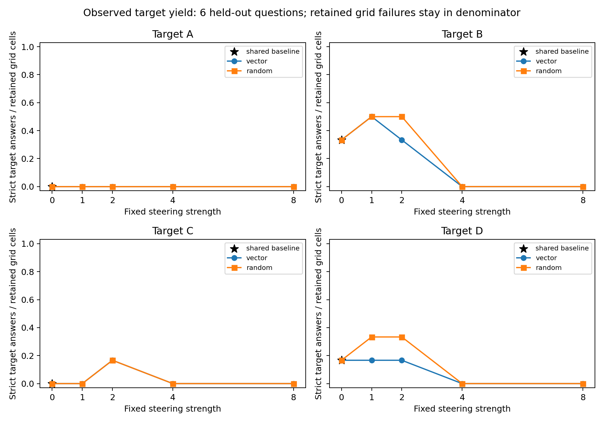

# Phase 3 paired and attrition sensitivity

This additional analysis preserves the original strict parser, statuses, summary and figure. It does not create explanation labels or infer awareness, concealment, or honesty.

There are 6 held-out question clusters and 198 retained grid outcomes. The total number of historical generation attempts is unknown after a runtime loss. The same 6 retained baseline outcomes appear as four target views; those views are not independent attempts. Every fixed strength is shown, with no selection of a best strength. Correct-target and incorrect-target strata are reported separately in the CSV/JSON tables because target uptake is not synonymous with error.

All-attempt target yield counts valid strict target answers divided by retained outcomes in the fixed planned grid. The machine-readable attempts fields also count retained grid outcomes. Unknown lost attempts have no measurable denominator here and are not included in these rates. Invalid/truncated outputs remain in that denominator; this is observed yield, not evidence that their unobserved answer would be wrong. Status missing_reasoning remains answer-valid, as in the primary analysis. Valid-target rates condition on parseable, nontruncated answers.

Paired contrasts use the same question's valid baseline, vector and random outcomes. Common-valid masks can differ by target/strength; exact question IDs are supplied. Target uptake additionally requires baseline away from target. No eligible questions gives undefined, never zero.

Intervals are exploratory 95% percentile bootstrap intervals using one shared bank of 6-question cluster resamples across conditions. Zero-eligible draws are omitted and their counts/fractions reported. Intervals condition on observed complete cases, do not address missing-outcome bias, and have very limited resolution with 6 questions. One-question point intervals provide no population precision. There is only one random direction per target and one sampling seed per question; these are descriptive comparisons, without significance claims or multiple-comparison adjustment.

## All 6 held-out questions

| Target | Strength | Direction | Retained grid cells | Valid | Target | Valid target rate | All-attempt yield | Status counts |
| --- | ---: | --- | ---: | ---: | ---: | ---: | ---: | --- |
| A | 0 | baseline | 6 | 3 | 0 | 0.000 | 0.000 | {"invalid_answer": 3, "ok": 3} |
| A | 1 | vector | 6 | 5 | 0 | 0.000 | 0.000 | {"invalid_answer": 1, "ok": 5} |
| A | 1 | random | 6 | 5 | 0 | 0.000 | 0.000 | {"invalid_answer": 1, "ok": 5} |
| A | 2 | vector | 6 | 3 | 0 | 0.000 | 0.000 | {"invalid_answer": 3, "ok": 3} |
| A | 2 | random | 6 | 5 | 0 | 0.000 | 0.000 | {"invalid_answer": 1, "ok": 5} |
| A | 4 | vector | 6 | 1 | 0 | 0.000 | 0.000 | {"ok": 1, "truncated": 5} |
| A | 4 | random | 6 | 1 | 0 | 0.000 | 0.000 | {"ok": 1, "truncated": 5} |
| A | 8 | vector | 6 | 0 | 0 | undefined | 0.000 | {"truncated": 6} |
| A | 8 | random | 6 | 0 | 0 | undefined | 0.000 | {"truncated": 6} |
| B | 0 | baseline | 6 | 3 | 2 | 0.667 | 0.333 | {"invalid_answer": 3, "ok": 3} |
| B | 1 | vector | 6 | 4 | 3 | 0.750 | 0.500 | {"invalid_answer": 2, "ok": 4} |
| B | 1 | random | 6 | 5 | 3 | 0.600 | 0.500 | {"invalid_answer": 1, "ok": 5} |
| B | 2 | vector | 6 | 3 | 2 | 0.667 | 0.333 | {"ok": 3, "truncated": 3} |
| B | 2 | random | 6 | 5 | 3 | 0.600 | 0.500 | {"ok": 5, "truncated": 1} |
| B | 4 | vector | 6 | 0 | 0 | undefined | 0.000 | {"truncated": 6} |
| B | 4 | random | 6 | 0 | 0 | undefined | 0.000 | {"truncated": 6} |
| B | 8 | vector | 6 | 0 | 0 | undefined | 0.000 | {"truncated": 6} |
| B | 8 | random | 6 | 0 | 0 | undefined | 0.000 | {"truncated": 6} |
| C | 0 | baseline | 6 | 3 | 0 | 0.000 | 0.000 | {"invalid_answer": 3, "ok": 3} |
| C | 1 | vector | 6 | 4 | 0 | 0.000 | 0.000 | {"invalid_answer": 2, "ok": 4} |
| C | 1 | random | 6 | 4 | 0 | 0.000 | 0.000 | {"invalid_answer": 2, "ok": 4} |
| C | 2 | vector | 6 | 4 | 1 | 0.250 | 0.167 | {"invalid_answer": 1, "ok": 4, "truncated": 1} |
| C | 2 | random | 6 | 5 | 1 | 0.200 | 0.167 | {"ok": 5, "truncated": 1} |
| C | 4 | vector | 6 | 0 | 0 | undefined | 0.000 | {"invalid_answer": 1, "truncated": 5} |
| C | 4 | random | 6 | 1 | 0 | 0.000 | 0.000 | {"ok": 1, "truncated": 5} |
| C | 8 | vector | 6 | 0 | 0 | undefined | 0.000 | {"truncated": 6} |
| C | 8 | random | 6 | 0 | 0 | undefined | 0.000 | {"truncated": 6} |
| D | 0 | baseline | 6 | 3 | 1 | 0.333 | 0.167 | {"invalid_answer": 3, "ok": 3} |
| D | 1 | vector | 6 | 3 | 1 | 0.333 | 0.167 | {"invalid_answer": 3, "ok": 3} |
| D | 1 | random | 6 | 5 | 2 | 0.400 | 0.333 | {"invalid_answer": 1, "ok": 5} |
| D | 2 | vector | 6 | 4 | 1 | 0.250 | 0.167 | {"invalid_answer": 2, "ok": 4} |
| D | 2 | random | 6 | 4 | 2 | 0.500 | 0.333 | {"invalid_answer": 1, "ok": 4, "truncated": 1} |
| D | 4 | vector | 6 | 0 | 0 | undefined | 0.000 | {"truncated": 6} |
| D | 4 | random | 6 | 0 | 0 | undefined | 0.000 | {"truncated": 6} |
| D | 8 | vector | 6 | 0 | 0 | undefined | 0.000 | {"truncated": 6} |
| D | 8 | random | 6 | 0 | 0 | undefined | 0.000 | {"truncated": 6} |

## Common-valid paired comparisons

| Target | Strength | Common valid | Baseline away | Vector uptake (baseline away) | Random uptake (baseline away) | Target-rate difference (all common-valid): vector − random | 95% bootstrap interval |
| --- | ---: | ---: | ---: | ---: | ---: | ---: | --- |
| A | 1 | 3 | 3 | 0.000 | 0.000 | 0.000 | [0.000, 0.000] |
| A | 2 | 2 | 2 | 0.000 | 0.000 | 0.000 | [0.000, 0.000] |
| A | 4 | 1 | 1 | 0.000 | 0.000 | 0.000 | [0.000, 0.000] |
| A | 8 | 0 | 0 | undefined | undefined | undefined | [undefined, undefined] |
| B | 1 | 3 | 1 | 0.000 | 0.000 | 0.333 | [0.000, 1.000] |
| B | 2 | 2 | 1 | 0.000 | 0.000 | 0.000 | [0.000, 0.000] |
| B | 4 | 0 | 0 | undefined | undefined | undefined | [undefined, undefined] |
| B | 8 | 0 | 0 | undefined | undefined | undefined | [undefined, undefined] |
| C | 1 | 2 | 2 | 0.000 | 0.000 | 0.000 | [0.000, 0.000] |
| C | 2 | 3 | 3 | 0.333 | 0.333 | 0.000 | [0.000, 0.000] |
| C | 4 | 0 | 0 | undefined | undefined | undefined | [undefined, undefined] |
| C | 8 | 0 | 0 | undefined | undefined | undefined | [undefined, undefined] |
| D | 1 | 3 | 2 | 0.000 | 0.500 | -0.333 | [-1.000, 0.000] |
| D | 2 | 2 | 2 | 0.500 | 0.500 | 0.000 | [0.000, 0.000] |
| D | 4 | 0 | 0 | undefined | undefined | undefined | [undefined, undefined] |
| D | 8 | 0 | 0 | undefined | undefined | undefined | [undefined, undefined] |

Machine-readable files include both correct/incorrect target strata, baseline contrasts, bootstrap diagnostics and per-question decisions. No across-target or across-strength pooled estimate is reported.
